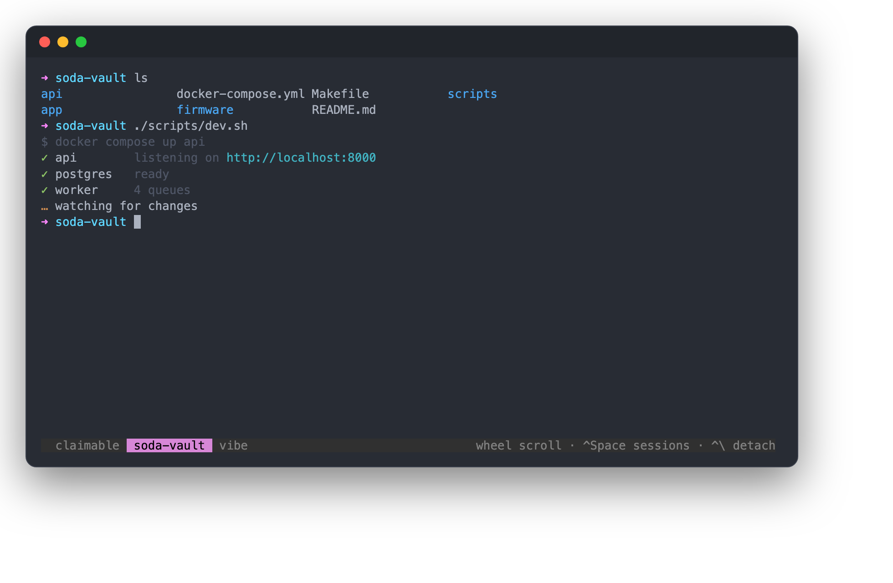
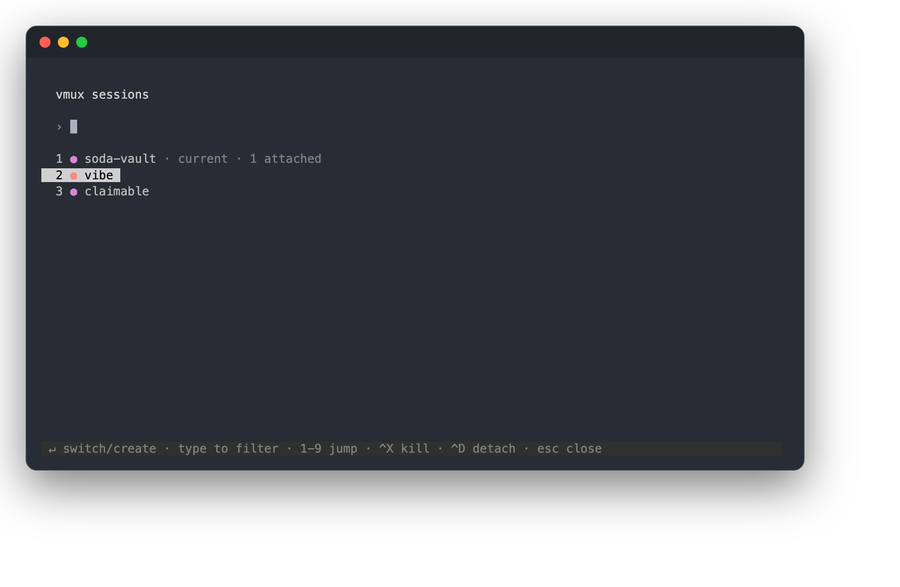
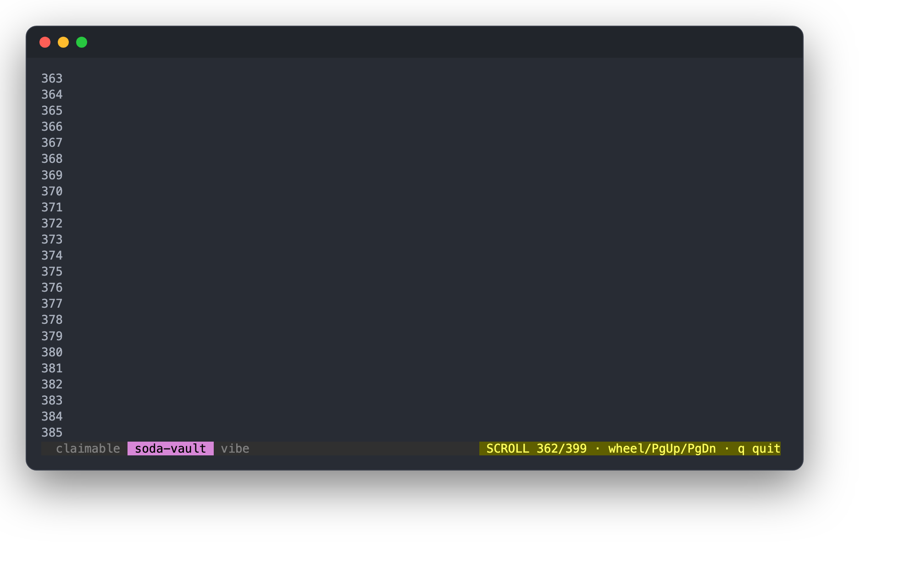
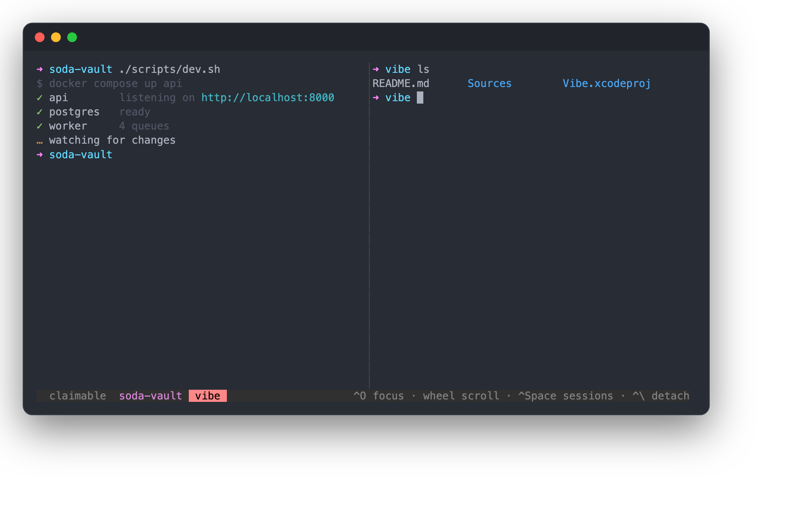

# perch

A terminal multiplexer that gets out of your way. Sessions you can actually
see, switch with one key, and scroll with your mouse.



## Why

tmux is great infrastructure with a rough cockpit. Three things kept biting:

- **Switching sessions is a ritual.** Prefix, then `s`, then navigate a tree.
- **Scrolling means learning copy-mode.** Your mouse wheel should just work.
- **You can never tell where you are.** Sessions named `0` and `1` in a dim
  status bar.

perch keeps the part of tmux that matters (persistent sessions on a background
server, detach and reattach at will) and rebuilds the cockpit around those
three complaints.

## What it does

**One key to go anywhere.** `Ctrl-Space` opens the session palette: type a few
letters to filter, Enter to switch. If nothing matches, Enter creates a session
with that name. Switching and creating are the same gesture. Tap `Ctrl-Space`
twice to bounce between your two most recent sessions like alt-tab.



**Scrolling that just works.** Mouse wheel scrolls history, with colors
preserved. `q` or scrolling back to the bottom returns to live. Inside
full-screen apps like `less` or `vim` the wheel turns into arrow keys, which is
what you meant anyway.



**Splits are just sessions.** Two ways to get sessions side by side:

```sh
perch api web        # open both at once, split
```

or from inside: `Ctrl-Space` to open the palette, pick a session, and press
`Ctrl-S` instead of Enter. Enter means "take me there"; `Ctrl-S` means "show
it next to what I have" (press it again on a visible session to remove it).
Up to three at once. Prefer them stacked top to bottom? `Ctrl-L` in the
palette flips the whole layout between side by side and stacked. There is no
separate pane primitive to learn: a split is just two sessions on screen at
once. `Ctrl-O` or a click moves focus, and the focused tile owns your keyboard
and cursor.



**You always know where you are.** Every session gets a stable identity color
derived from its name. The current session is highlighted in the status bar,
the other sessions sit next to it (click one to switch), and your terminal tab
title follows along.

**One session per project, automatically.** Bare `perch` inside
`~/dev/my-app` attaches or creates a session named `my-app`, starting in that
directory. Your sessions end up mapping one-to-one to your projects without
you naming anything.

## Install

```sh
go install github.com/MurkyPuma/perch@latest
```

`go install` puts the binary in `$(go env GOPATH)/bin` (usually `~/go/bin`),
which is not on your PATH by default. If `perch` is not found afterwards:

```sh
echo 'export PATH="$HOME/go/bin:$PATH"' >> ~/.zshrc && source ~/.zshrc
```

Or from a clone:

```sh
git clone https://github.com/MurkyPuma/perch
cd perch && go build && cp perch /usr/local/bin/
```

Built and tested on macOS. It is a single static binary, so you can also
`scp` it to a Linux box and get the same setup over SSH (`GOOS=linux go build`).

## Use

```sh
perch                # attach or create a session named after the current directory
perch api            # attach or create the session "api"
perch api web        # open "api" and "web" side by side
perch ls             # list sessions
perch kill-server    # stop everything
```

| Key | Action |
| --- | --- |
| `Ctrl-Space` | open the session palette |
| type + `Enter` | filter sessions, or create one by typing a new name |
| `Ctrl-Space` `Ctrl-Space` | jump to the previous session (alt-tab) |
| `1` to `9` | jump to the nth session in the palette |
| `Ctrl-X` | kill the selected session (in the palette) |
| `Ctrl-S` | in the palette: split with the selected session (again to unsplit) |
| `Ctrl-O` | cycle focus between split tiles |
| `Ctrl-\` | detach, sessions keep running |
| mouse wheel | scroll history; `q` or `Esc` to return |
| `PgUp` / `PgDn`, `g` / `G` | move around in scrollback |
| click a session name | switch to it |

There is no configuration file yet, on purpose. The defaults are the product.

## How it works

A small background server owns the sessions. Each session is one shell on a
PTY, mirrored into a virtual terminal (via
[vt10x](https://github.com/hinshun/vt10x)) so the screen can be repainted on
attach and switch, plus a line-based history buffer that preserves colors for
scrollback. The client you run in your terminal is a dumb pipe: raw stdin up,
rendered frames down, over a unix socket. All key handling and rendering is
server-side, which is what makes detach, reattach, and multi-client attach
straightforward.

Frames are line-diffed against the previous paint, so live output is cheap and
flicker-free. Application quirks are translated in the middle: DECCKM arrow
mode, bracketed paste, alt-screen detection, and mouse passthrough for apps
that ask for it.

## Not there yet

- Horizontal splits and nested layouts (side-by-side columns only for now)
- Mouse text selection straight to the system clipboard
- Search inside scrollback
- Activity indicators for background sessions
- Sessions that survive a reboot

## Development

```sh
go test ./...        # unit tests + an end-to-end test driving a real PTY
go run ./hack/snap out/   # regenerate the README screenshots
```

The screenshots above are real: `hack/snap` scripts an actual perch server and
client under a PTY, mirrors the client into a virtual terminal, and renders
the result to PNG with headless Chrome.

## License

MIT
